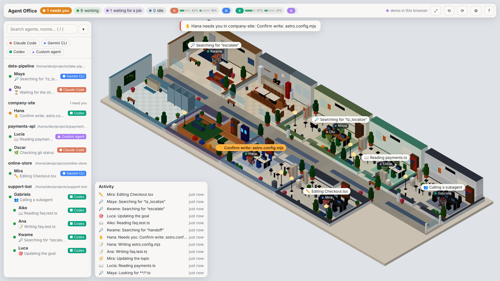

# Agent Office

A 3D virtual office in your browser that shows what your AI coding agents are doing, live. Each project with an
open session becomes a room, and each agent is a character in it:

- it sits and types while it works;
- it raises a hand when it needs you;
- it wanders to the coffee machine (or the ping-pong table) when it's idle;
- as a subagent, it walks its result over to its parent;
- it turns off the lights when the session ends.



- **Works with several tools:** Claude Code, Gemini CLI, Codex and your own agents report through one event
  protocol.
- **Themeable:** five built-in themes (modern, industrial loft, traditional, startup, cozy cabin), seasonal
  decorations, or your own theme pack ([docs/themes.md](docs/themes.md)).
- **Local and private:**
  - binds to `127.0.0.1` and reads agent folders read-only;
  - never opens credential files;
  - masks secrets and sends no telemetry.

## Desktop app (Windows)

Download `Agent-Office-Setup-<version>.exe` from the [Releases page](../../releases): no Node.js needed. It gives you a
window, a small always-on-top **widget** and a **tray icon** that shows when an agent needs you. Windows may warn
about an unknown publisher because the installer isn't signed yet. Details: [docs/desktop.md](docs/desktop.md).

## Install a release (command line)

Download the package from the [Releases page](../../releases) (`.zip` for Windows, `.tar.gz` for Linux and macOS), unpack
it and run the installer. You need Node.js 22.12 or newer.

```powershell
powershell -ExecutionPolicy Bypass -File .\install.ps1      # Windows: also adds a Start Menu shortcut
```

```bash
./install.sh                                                # Linux and macOS
```

Then `agent-office start --open` (or the Start Menu shortcut). The package's own README lists every command. How
releases are made: [docs/releasing.md](docs/releasing.md).

## Try it from source

You need Node.js 22.12 or newer.

```bash
git clone <this repository> agent-office && cd agent-office
npm ci
npm run demo          # simulated agents from every provider, at http://127.0.0.1:4848
```

To watch your real agents:

```bash
npm run build && npm start          # http://127.0.0.1:4848 (AGENT_OFFICE_PORT changes the port)
```

`npm run dev` is the same with live reload. Add `?mock=1` to the URL to see the demo without a server.

## Per provider

| Provider | What you need | Install | Uninstall |
| --- | --- | --- | --- |
| **Claude Code** | Nothing: the office reads `~/.claude*` (or `AGENT_OFFICE_CLAUDE_DIRS`). | — | — |
| Claude Code plan usage (optional) | A statusline tap for the 5-hour and weekly bars. | `npm run usage:install` | `npm run usage:uninstall` |
| **Gemini CLI** ≥ 0.65 | Hooks forward events to the office. | `npm run hooks:install -- --provider gemini-cli` | `npm run hooks:uninstall -- --provider gemini-cli` |
| **Codex** | Nothing to watch sessions; hooks are optional (live tool activity). Trust them in Codex's `/hooks`. | `npm run hooks:install -- --provider codex` | `npm run hooks:uninstall -- --provider codex` |
| **Your own agent** | The TypeScript or Python SDK ([sdk/README.md](sdk/README.md)), or `POST /api/events`. | — | — |

Every installer:

- backs up the file first;
- merges only its own entries;
- supports `npm run hooks:status -- --provider <id>`.

Details for each provider are in [docs/providers/](docs/providers/).

### Interacting from the office (off by default)

These features act on your sessions:

- approve Claude Code's permission requests and answer its questions;
- send messages to Claude Code, Codex and SDK agents;
- read any agent's conversation.

They need `AGENT_OFFICE_INTERACTIVE=1` on a local bind. Read [docs/interactive.md](docs/interactive.md) for setup
and risks before turning them on.

## Using it

- **Move around:**
  - drag to pan, the wheel to zoom;
  - Q and E (or right-drag) to turn;
  - F to see the whole office.
- **Inspect:** click a character or a room for details. The sidebar lists everyone: `/` searches, and arrow keys
  move through the list.
- **Settings (`,`):**
  - theme, names, bubbles, how much idle agents wander;
  - day and night, seasonal decorations, motion;
  - sounds and browser notifications (both off by default).
- **Help:** `?` lists the shortcuts.

## Privacy

Agent Office only reads what agents write to disk or send through hooks, and it:

- **never opens credential files** (`.credentials*`, `auth.json`, `oauth_creds.json`, `*.key`, env files);
- **drops sensitive transcript records unparsed** (Claude Code's full API requests and organization credentials);
- **masks secrets and cuts text** before anything reaches the browser, the logs or the disk;
- **keeps your conversation out of its logs**;
- **makes no outbound calls at all.**

The threat model is in [docs/security.md](docs/security.md).

## Troubleshooting

| Symptom | Check |
| --- | --- |
| A Claude Code session doesn't appear | Is its config folder found? `GET /api/health` lists the sources. Set `AGENT_OFFICE_CLAUDE_DIRS` for unusual locations. |
| Gemini CLI agents never appear | `npm run hooks:status -- --provider gemini-cli`; Gemini must be ≥ 0.65 (older versions have hooks off). Restart open sessions after installing. |
| Codex tool activity lags | Without hooks, the office follows the rollout files. Install the hooks for live activity. |
| "Host not allowed" | Open the office at `http://localhost:<port>` or by IP, or add the name to `AGENT_OFFICE_ALLOWED_HOSTS`. |
| Agents in Docker show as offline | Set `AGENT_OFFICE_IN_DOCKER=1`: the agents' PIDs belong to the host. |
| Slow on an older laptop | Settings → Characters → Simple shapes; `?stats=1` shows fps and draw calls ([docs/perf.md](docs/perf.md)). |
| Approve/message buttons missing | They need `AGENT_OFFICE_INTERACTIVE=1` on a loopback bind ([docs/interactive.md](docs/interactive.md)). |

## Contributing

See [CONTRIBUTING.md](CONTRIBUTING.md). The plan lives in [TASKS.md](TASKS.md), decisions in [docs/adr/](docs/adr/),
and the change log in [CHANGES.md](CHANGES.md).

## License

[MIT](LICENSE). Portions are ported from Habblaud (MIT); see [NOTICE.md](NOTICE.md). Third-party assets are CC0 and
listed in [ASSETS.md](ASSETS.md).
