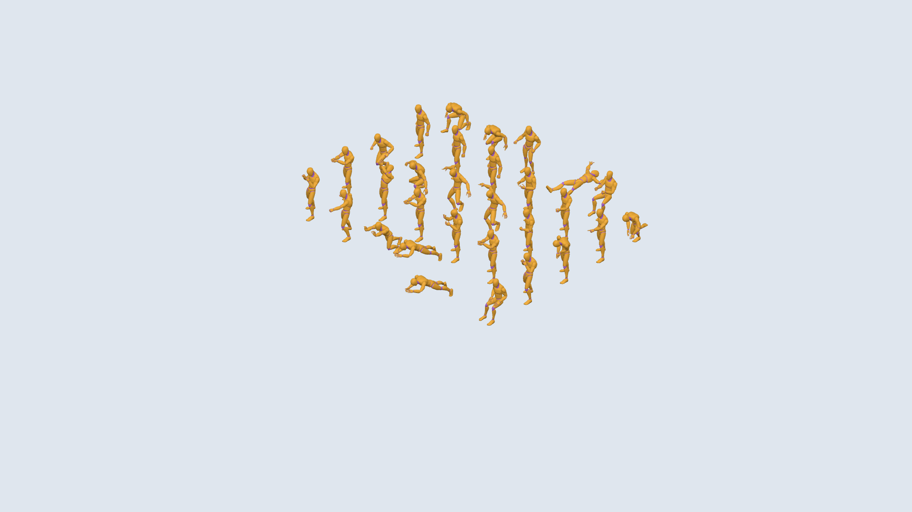

# Spike: assets (P0-07)

2026-10-24. Sources, licenses, compression and load/animation cost, measured on the same machine as the
[renderer spike](renderer.md) (Intel UHD Graphics, 1920×1080). Spike code: [`spikes/assets/`](../../spikes/assets/).
Raw numbers: [`assets/results.json`](assets/results.json). **No asset files are committed yet**; the spike served
them from a scratch folder.

## Characters: Quaternius (CC0)

| Pack | What it is | License (verified) | Get it |
| --- | --- | --- | --- |
| **Universal Animation Library**, Standard | 45 clips + a mannequin on one humanoid rig (GLB for Godot, FBX for Unity/Unreal) | CC0 1.0: `License.txt` in the download and [OpenGameArt](https://opengameart.org/content/universal-animation-library) | Direct zip on OpenGameArt (14.5 MB) |
| **Universal Base Characters**, Standard | 2 base bodies + 5 hairstyles, ~13k triangles, "compatible with the Universal Animation Library" | CC0 1.0 per the [itch.io page](https://quaternius.itch.io/universal-base-characters) | itch.io "name your price" ($0 works), 122 MB zip. Needs a browser click, so **not downloaded in this spike** |

The animation library's GLB, inspected:

| | |
| --- | --- |
| Skin | 1 skin, **53 joints** (Rigify `DEF-*` names, including 30 finger bones) |
| Mesh | 1 mannequin mesh, 13,744 triangles, 2 materials (`M_Main`, `M_Joints`), no textures |
| Clips (45 + T-pose) | `Idle_Loop`, `Idle_Talking_Loop`, `Walk_Loop`, `Walk_Formal_Loop`, `Jog_Fwd_Loop`, `Sprint_Loop`, `Sitting_Enter`, `Sitting_Idle_Loop`, `Sitting_Talking_Loop`, `Sitting_Exit`, `Interact`, `PickUp_Table`, `Push_Loop`, `Dance_Loop`, `Driving_Loop`, `Fixing_Kneeling`, `Crouch_*`, `Jump_*`, `Roll`, `Swim_*`, combat clips |

**Coverage of the poses we need:**

| Pose | Clip |
| --- | --- |
| idle | ✅ `Idle_Loop` |
| walk | ✅ `Walk_Loop` / `Walk_Formal_Loop` |
| run | ✅ `Jog_Fwd_Loop` / `Sprint_Loop` |
| sit | ✅ `Sitting_Enter` → `Sitting_Idle_Loop` → `Sitting_Exit` |
| talk | ✅ `Idle_Talking_Loop`, `Sitting_Talking_Loop` |
| cheer | ⚠️ `Dance_Loop` as a stand-in |
| **type** | ❌ none |
| **wave** | ❌ none |
| **sleep** | ❌ none |
| **raise hand ("needs you")** | ❌ none |

The paid Source tier (120+ clips) may cover more; the free tier doesn't. **Recommendation:** build the missing
four as **procedural pose layers** in the renderer: bone overrides blended on top of a base clip.

- type = forearms and hands oscillating over `Sitting_Idle_Loop`;
- raise hand = an upper-arm and forearm override;
- wave = raise hand plus forearm swing;
- sleep = head and spine pitched down over `Sitting_Idle_Loop` at a slow time scale.

Anything that looks wrong gets authored in Blender in Phase 3.

> A third-party blog claims these packs share a 65-joint skeleton. The GLB we inspected has 53 joints. Trust the
> files, and check the base-characters GLB against the animation library before P3-02.

## Furniture: Kenney Furniture Kit (CC0)

- [kenney.nl/assets/furniture-kit](https://kenney.nl/assets/furniture-kit), v2.0 (2018). CC0 per the bundled
  `License.txt`. 140 GLB models (2.3 MB as separate files), plus OBJ/FBX and isometric PNGs.
- Models are tiny (60–600 triangles), **untextured**, with **materials named by surface** (`wood`, `woodDark`,
  `metal`, `metalDark`, `carpet`, `plant`, …). A theme can recolor or re-material each slot by name, which fits the
  theme-pack design. They use `KHR_materials_unlit`; **the pipeline strips it** so lighting applies.
- Kinds covered: `desk`, `deskCorner`, `chairDesk`, `computerScreen`, `computerKeyboard`, `computerMouse`,
  `laptop`, `kitchenCoffeeMachine`, `kitchenFridge*`, `loungeSofa*`, `loungeChair*`, `pottedPlant`, `plantSmall*`,
  `bookcase*`, `coatRack*`, `toilet`, `bathroomSink`, `lamp*`, `rug*`, `table*`, `trashcan`, `televisionModern`,
  `speaker`, `stoolBar*`, `kitchenBar` (can serve as a reception desk), `ceilingFan`, walls, doorways, stairs.
- **Not covered:** `water_cooler`, `whiteboard`, filing cabinet, cubicle partitions, ping-pong table, bean bag,
  neon sign, `elevator`, `light_switch`. These start as procedural defaults (beveled boxes, as in P2-06) and are
  replaced per theme later.
- Textured themes (industrial brick and concrete, traditional carpet tiles) need CC0 texture sets, e.g. from
  ambientCG or Poly Haven, verified per texture when a theme is built (Phase 4).

## Compression (gltf-transform 4.5.1, meshopt)

| File | Raw | meshopt | gzip of raw | **gzip of meshopt** |
| --- | ---: | ---: | ---: | ---: |
| Animation library (mannequin + 45 clips) | 6.67 MB | 1.78 MB | 2.41 MB | **305 KB** |
| Same, mesh simplified to 25% (3,435 triangles) | 6.01 MB | 1.73 MB | — | **277 KB** |
| Furniture kit, 140 models merged into one GLB | 1.84 MB | 0.71 MB | 317 KB | **193 KB** |

- Command: `gltf-transform optimize in.glb out.glb --compress meshopt --texture-compress false --simplify false`
  (~3 s for the animation library). Furniture: `gltf-transform merge *.glb kit.glb`, then `optimize` with
  `--join false --flatten false`, which keeps models separable.
- Animation data dominates the character file: simplifying the mesh barely changes the size.
- **KTX2 wasn't tested.** It needs KTX-Software's `toktx`, which isn't installed, and neither pack has textures.
  P3-01 adds it for theme textures.

## Load and animation cost (Chrome, Intel UHD, 1080p)

| Run | Characters × triangles | Fetch + parse | Clone all | Mixer ms p50 / p95 | CPU frame p50 | GPU-synced ms p50 / p95 | Draw calls |
| --- | --- | ---: | ---: | ---: | ---: | ---: | ---: |
| raw | 30 × 13,744 | 63 + 79 ms | 29 ms | 1.7 / 3.9 | 4.9 ms | 13.3 / 15.1 | 60 |
| meshopt | 30 × 13,744 | 25 + 44 ms | 26 ms | 1.2 / 2.9 | 3.9 ms | 12.8 / 14.6 | 60 |
| meshopt | 60 × 13,744 | 30 + 33 ms | 40 ms | 2.2 / 4.3 | 7.4 ms | **17.4 / 21.1** | 120 |
| meshopt, 25% LOD | 30 × 3,435 | 29 + 54 ms | 29 ms | 1.2 / 3.6 | 4.6 ms | 10.7 / 12.4 | 60 |
| meshopt, 25% LOD | 60 × 3,435 | 22 + 35 ms | 48 ms | 2.4 / 5.0 | 8.1 ms | **16.5 / 18.2** | 120 |

The furniture kit fetches and parses in 8 + 21 ms (meshopt) vs. 16 + 36 ms (raw).



## Findings

1. **Loading is a non-issue:** < 100 ms for a character with all clips, < 30 ms for the furniture kit, ~0.5 MB over
   the wire. A theme pack will sit far under the 15 MB limit.
2. **30 animated characters fit the budget**, at ~13 ms GPU-synced on this iGPU, characters alone.
3. **60 characters don't**, even at 25% triangles (16.5 ms). The cost per character is draw calls (2 materials →
   2 calls), 53 bones (30 of them fingers) and mixer updates, not triangles.
4. Combined with the office (~11–12 ms in the renderer spike), 30 full-detail characters will be tight. P3-06 must
   apply the levers below.

## Recommendations (recorded in [ADR 0004](../adr/0004-assets.md))

1. **Characters:** Quaternius **Universal Base Characters** (body) + **Universal Animation Library** (clips), both
   CC0, Standard tiers. Appearance from the seed via material colors, hair meshes and accessories (P3-03). Build the
   missing poses (type, wave, sleep, raise hand) as procedural pose layers.
2. **Per character:** **one material** (merge `M_Main`/`M_Joints` into one with a small palette texture or vertex
   colors), a **trimmed skeleton** without finger bones (53 → ~23 joints), and a **25% LOD** for overview zoom.
3. **Animation:** update mixers at full rate only for characters on screen and large enough to see. Others update at
   10–15 Hz or freeze (P3-06).
4. **Furniture:** Kenney Furniture Kit as the base set for every theme. Strip `KHR_materials_unlit`. Map material
   names to theme materials. One merged meshopt GLB per theme. Procedural defaults for the kinds it lacks.
5. **Pipeline (P3-01):** `gltf-transform` (pinned) with merge → optimize (meshopt, `--simplify false`) → LOD
   simplify for characters → KTX2 (`toktx`) for textures. Budget checks for triangles, joints, materials and
   texture size, and `ASSETS.md` is checked in CI.

## Needs a human

- Download **Universal Base Characters [Standard]** from https://quaternius.itch.io/universal-base-characters
  (choose $0, or support the author). itch.io requires a browser. Keep it out of git (`reference/` or `assets-src/`)
  until P3-01 decides what gets committed.

## Reproduce

```sh
# in an empty scratch folder (downloads are untrusted data: keep them out of the repo)
curl -LO https://opengameart.org/sites/default/files/universal_animation_librarystandard.zip
curl -LO https://kenney.nl/media/pages/assets/furniture-kit/440e0608a4-1677580847/kenney_furniture-kit.zip
# unzip both, then with @gltf-transform/cli 4.5.1:
cp "Animation Library[Standard]/Godot/AnimationLibrary_Godot_Standard.glb" ual-raw.glb
gltf-transform optimize ual-raw.glb ual-meshopt.glb --compress meshopt --texture-compress false --simplify false
gltf-transform simplify ual-raw.glb ual-lod.glb --ratio 0.25 --error 0.01
gltf-transform optimize ual-lod.glb ual-lod-meshopt.glb --compress meshopt --texture-compress false --simplify false
(cd "Models/GLTF format" && gltf-transform merge *.glb ../../kenney-merged.glb)
gltf-transform optimize kenney-merged.glb kenney-meshopt.glb --compress meshopt --texture-compress false --simplify false --join false --flatten false
# measure (from the repo root)
node spikes/assets/measure.mjs <that scratch folder>
```
