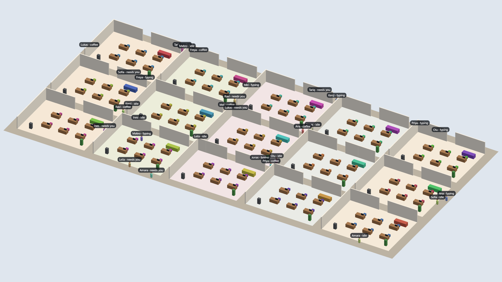
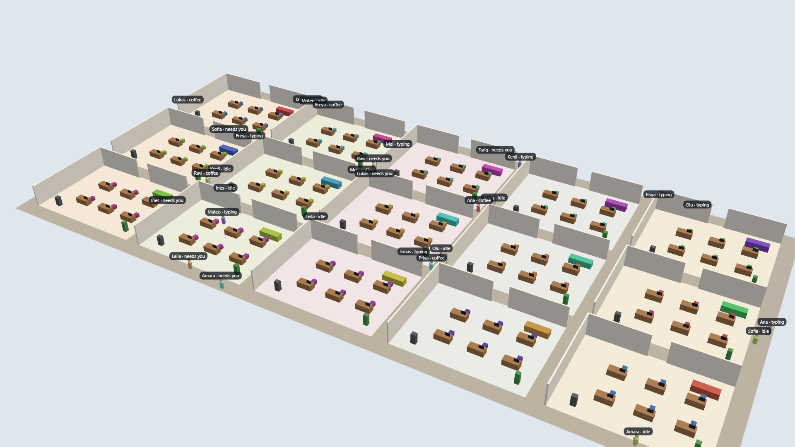
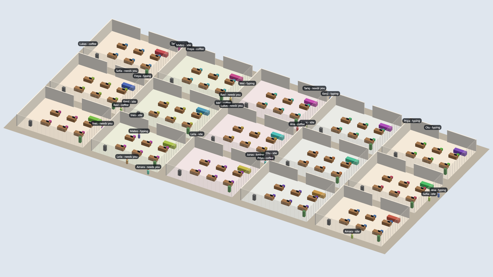
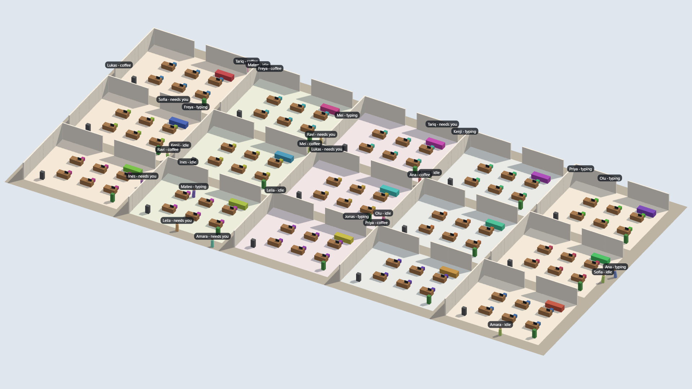

# Spike: 3D renderer (P0-06)

2026-10-24. A throwaway Three.js page ([`spikes/renderer/`](../../spikes/renderer/)) and a Playwright harness that
measured it on this machine. Raw numbers: [`renderer/results.json`](renderer/results.json).

## Machine

| | |
| --- | --- |
| GPU | **Intel UHD Graphics** (integrated, i7-10510U). WebGL reports `ANGLE (Intel, Intel(R) UHD Graphics (0x00009B41) Direct3D11)`. |
| CPU / RAM | Intel Core i7-10510U, 4 cores / 8 threads, 23.6 GB |
| Display | 1920×1080 at 60 Hz, device pixel ratio 1 |
| Browser | Chrome (headless, real GPU through ANGLE/D3D11), Three.js 0.186.1 |

This is the **target hardware class** of CLAUDE.md's performance budget (integrated GPU, 1080p).

## Scene

- 15 rooms (5 × 3) of 16 × 12 m with 2 m corridors; office grid 92 × 44 tiles; 3 m walls; a doorway in each room.
- Floors: one merged mesh with vertex colors. Walls: 810 one-tile segments in one `InstancedMesh`. Furniture: one
  `InstancedMesh` per kind (desk, monitor, chair, coffee machine, sofa, plant), 90 desks in total.
  `MeshStandardMaterial` everywhere; hemisphere + directional light.
- 30 characters walking random cross-office routes with Habblaud's A* (copied), plus 30 `CSS2DRenderer` labels.
  The camera orbits at 12°/s, so the cutaway re-layouts are part of the measurement.
- Three ways to draw characters:
  - `instanced`: one `InstancedMesh` for bodies and one for heads;
  - `meshes`: 3 meshes per character (body, head, provider badge);
  - `skinned`: one procedural `SkinnedMesh` per character (4 bones, animated) plus a head. This is a stand-in for
    the rigged glTF characters of Phase 3.

## Method

- 3 s warm-up, then 10 s of measurement per configuration at 1920×1080.
- **rAF fps** and frame interval come from `requestAnimationFrame` timestamps.
- **CPU ms** is the time inside our frame function: sim + cutaway + `render()` + labels.
- **Burst ms** is the cost of a frame forced to finish on the GPU: 60 frames back to back, each followed by a 1-pixel
  `readPixels`. This is the **capacity** measure.
- **Headless Chrome paces rAF at ~54–57 Hz even on an empty page** (measured: 45.8–54.8 fps). Every configuration
  hit that ceiling (56.5 ± 0.3 fps), so rAF fps says nothing about headroom. Burst ms does.

## Results

| Configuration | Draw calls | Triangles | CPU ms p50 / p95 | Burst ms p50 / p95 |
| --- | ---: | ---: | ---: | ---: |
| ortho, walls full (`none`), meshes | 98 | 26,852 | 1.0 / 3.3 | 12.6 / 13.7 |
| ortho, `hide`, meshes | 98 | 21,812 | 1.1 / 3.7 | 11.9 / 13.2 |
| ortho, `cut`, meshes | 98 | 26,852 | 1.1 / 3.5 | 11.6 / 12.8 |
| ortho, `fade`, meshes | 99 | 26,852 | 0.9 / 2.8 | 11.9 / 12.5 |
| persp, `none`, meshes | 98 | 26,852 | 0.9 / 2.6 | 12.3 / 13.5 |
| persp, `hide`, meshes | 98 | 21,812 | 0.8 / 2.8 | 11.3 / 12.1 |
| persp, `cut`, meshes | 98 | 26,852 | 0.9 / 3.1 | 12.4 / 13.1 |
| persp, `fade`, meshes | 99 | 26,852 | 1.2 / 3.3 | 12.3 / 13.4 |
| ortho, `hide`, **instanced** | **10** | 21,452 | 0.6 / 1.1 | 11.4 / 12.6 |
| ortho, `hide`, **skinned** | 68 | 21,452 | 1.2 / 2.1 | 12.1 / 13.2 |
| ortho, `hide`, instanced, **shadows** | 19 | 42,872 | 0.9 / 1.8 | 12.2 / 13.4 |
| ortho, `hide`, meshes, **shadows** | **195** | 43,592 | 3.1 / 7.0 | 11.4 / 13.7 |
| ortho, `hide`, skinned, **shadows** | 105 | 35,312 | 2.6 / 9.5 | 10.7 / 14.4 |
| ortho, `hide`, meshes, **no labels** | 98 | 21,812 | 0.7 / 1.3 | 11.0 / 11.4 |
| ortho, `hide`, meshes, **60 agents** | 188 | 35,132 | 3.1 / 6.1 | 11.9 / 13.2 |
| ortho, `hide`, meshes, **no MSAA** | 98 | 21,812 | 1.2 / 1.9 | **7.1 / 7.4** |
| ortho, `hide`, meshes, shadows, **no MSAA** | 195 | 43,592 | 1.7 / 3.3 | 10.5 / 11.4 |

Other measurements:

- A* across the whole office: **0.11–0.15 ms per search** (92 × 44 grid, 32–64 searches per run).
- Cutaway re-layout: **5 times in 13 s** of orbiting, only when the camera crosses a 90° quadrant.
- JS heap: 8–40 MB.
- Programs: 4–12.

## Findings

1. **The CPU is not the problem.** A full frame costs ~1 ms (p50) and at most 9.5 ms (p95, skinned with shadows).
2. **The integrated GPU is fill-bound, not draw-call-bound.** Going from 10 to 195 draw calls barely changes the
   GPU cost. **MSAA costs ~5 ms** at 1080p (11.9 → 7.1 ms). Shadows (2048² map) add 0–3.5 ms (noisy). With MSAA
   and shadows on, a frame takes ~11–14 ms. That still meets 60 fps, with ~3–5 ms to spare.
3. **That leaves little room for post-processing.** SSAO or bloom at full 1080p will not fit on this GPU together
   with MSAA and shadows. `postfx` in a theme must be a request that the renderer may downgrade, not a guarantee.
4. **Draw calls only matter for the budget (< 300).** Three meshes per character with shadows reach 195 calls at 30
   agents and ~380 at 60. One skinned mesh per character is 68, or 105 with shadows.
5. **Labels are cheap** (~0.4 ms CPU for 30 `CSS2DRenderer` labels) but **collide** at overview zoom. P2-08 needs
   decluttering.
6. **At a full 15-room overview, characters are ~10 px tall.** The default camera must frame a few rooms and zoom
   out on demand.

## Camera: orthographic vs. perspective

| Orthographic isometric | Perspective |
| --- | --- |
|  |  |

- **Orthographic:** one scale everywhere. Far rooms and their labels read as well as near ones, the diorama look
  holds, and picking and label placement are simpler. The GPU cost is the same.
- **Perspective:** more depth and drama, but far rooms shrink and their labels pile up. It's better for a close
  "follow this agent" view.

## Cutaway

| `cut` (front walls at 0.35 m) | `hide` (front walls removed) | `fade` (front walls at 22% opacity) |
| --- | --- | --- |
|  |  |  |

- **`cut`:** every room outline and doorway stays readable, and the interior is fully visible. **Best overall.**
- **`hide`:** the front room boundaries disappear, and only the floor tint shows where a room ends.
- **`fade`:** striped artifacts, because each transparent wall tile sorts and blends on its own. It would need
  merged wall geometry and sorting work, and it costs the same as the others.

All three cost the same, and the re-layout runs only at quadrant changes.

Skinned characters with shadows, for depth: 

## Recommendations (recorded in [ADR 0003](../adr/0003-renderer-and-camera.md))

1. **Camera:** orthographic isometric by default (pitch 35.264°, yaw 45° + k·90°). Rotate in animated 90° steps,
   with zoom and pan. The default framing fits ~4–6 rooms; "fit office" is one key away. Perspective only as an
   optional follow-cam.
2. **Cutaway:** `cut` by default (camera-facing walls cut to ~0.4 m), `hide` as a setting, no `fade`. Re-lay walls
   only when the facing set changes.
3. **Static geometry:** merged floors, and one `InstancedMesh` per wall type and furniture kind (per theme
   material). The whole building should take < 30 draw calls.
4. **Characters (Phase 3):** **one skinned mesh and one material per character** (texture atlas, accessories merged
   into the skin), so at most 2 draw calls per character including attachments. Use **blob shadows** (one instanced
   decal) for characters rather than shadow-map casters. That keeps 60 agents under 300 calls with shadows.
5. **Quality tiers** chosen from measured frame time:
   - **Low:** no MSAA, no shadows.
   - **Medium** (default on integrated GPUs): MSAA, static shadow map updated only when the scene changes, no
     post-fx.
   - **High:** adds the theme's post-fx.

   Fall back to dynamic resolution when the 95th percentile frame time goes over 15 ms.
6. **Measuring:** budgets in CI and `docs/perf.md` use **burst ms (GPU-synced)**, not headless rAF fps.

## Reproduce

```sh
node spikes/renderer/measure.mjs              # full matrix (~5 min), writes spikes/renderer/out/
node spikes/renderer/measure.mjs --only=aa-0  # a subset by name
```
